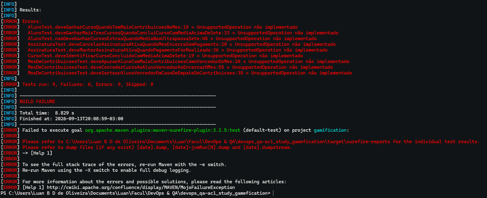
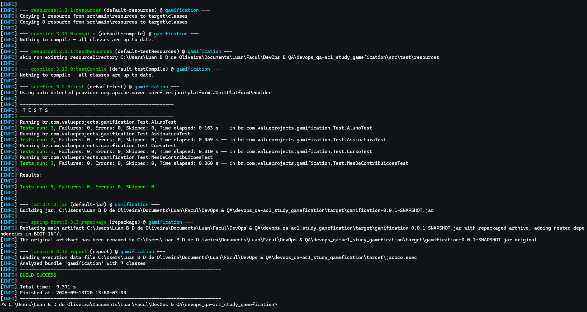
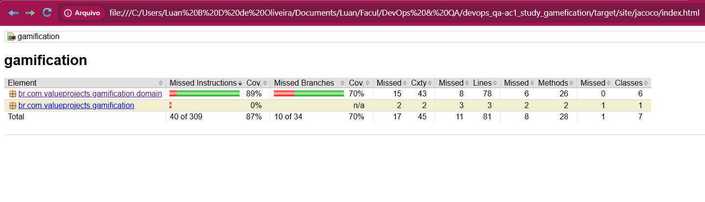
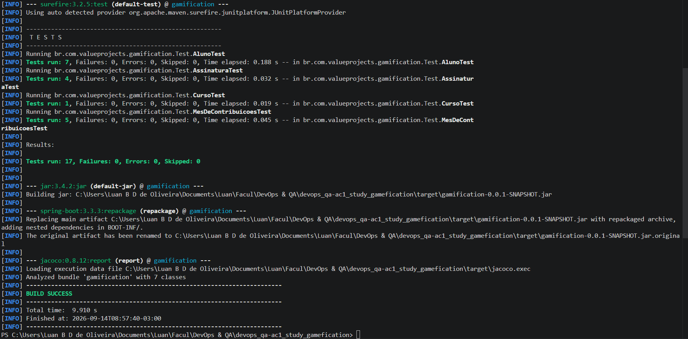
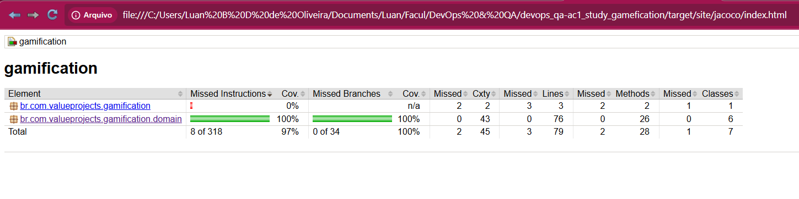
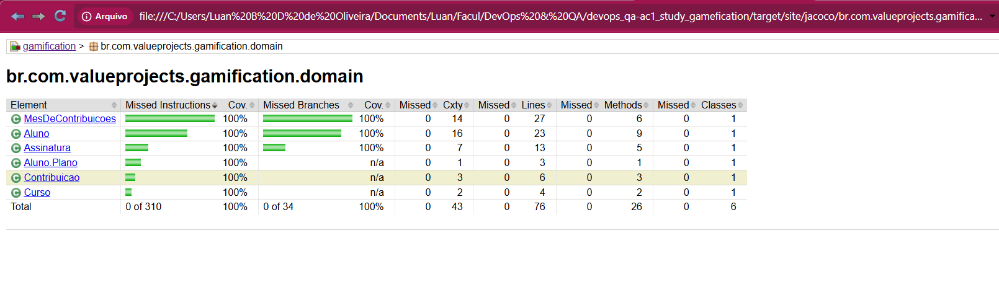
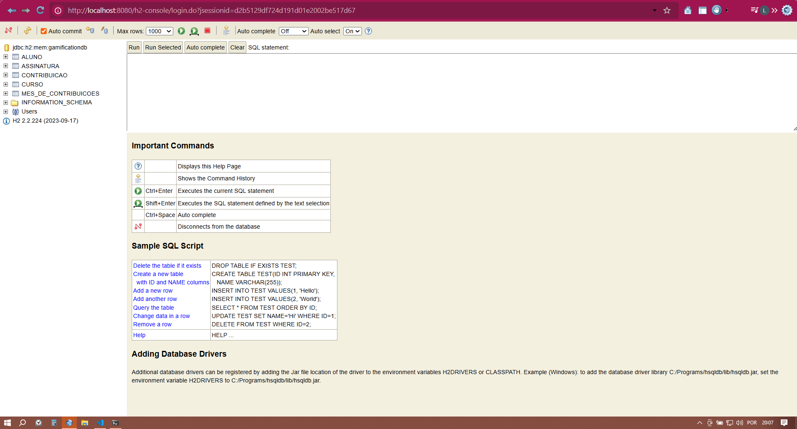
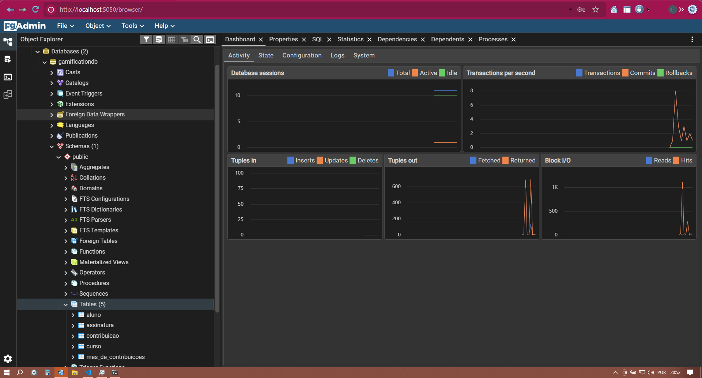
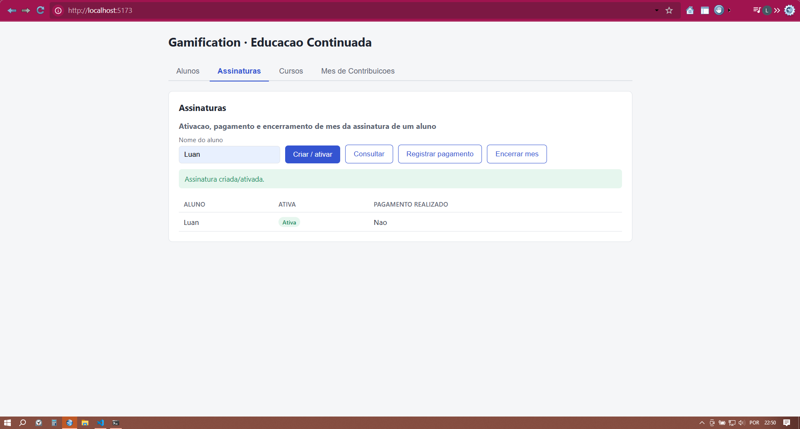

# Gamification — AC1 DevOps & QA

Projeto da disciplina **DevOps & QA** (Engenharia de Computação), desenvolvido em ciclo **TDD (RED → GREEN → BLUE)** a partir de cenários BDD, com API REST em Spring Boot, persistência em PostgreSQL, um frontend Vue para validação manual dos endpoints e orquestração via Docker Compose.

**Integrante do grupo:**

- Juan Pedro Jerônimo Guilen, RA: 200679.
- Luan Bruno Domingues de Oliveira, RA: 210200.


## Estudo de caso — Gamificação para Engajamento de Educação Continuada

Uma plataforma vende cursos online e EAD no modelo de assinaturas. O aluno paga uma mensalidade e tem acesso a um conjunto de cursos do plano básico. A cada curso concluído com média acima de 7,0, o aluno ganha o direito de realizar mais 3 cursos. O aluno que mais escrever tópicos no fórum e ajudar outros participantes com seus comentários ganha um curso extra ao final do mês (em caso de empate, o vencedor é sorteado). Ao acumular 12 cursos, o plano do aluno passa a ser **Premium**, com voucher para participar de projetos reais durante os cursos e recebimento de 3 moedas, conversíveis em novos cursos, acumuláveis ou resgatáveis em criptomoeda.

## User Stories

User stories elaboradas. (As duas primeiras US foram elaboradas por Luan Bruno, e as duas últimas por Juan Pedro)

| Autor | ID | Persona   | Como...                          | Eu quero...                                             | Para que...                                          |
|-------|----|-----------|-----------------------------------|----------------------------------------------------------|--------------------------------------------------------|
| Luan  | 1  | ADM       | aluno curioso e esforçado         | ser recompensado pela contribuição em discussões          | adquirir mais cursos e ampliar meu conhecimento         |
| Luan  | 2  | ALUNO     | aluno de cursos                   | participar e contribuir com outros alunos                 | ajudar a compartilhar o conhecimento                    |
| Juan  | 3  | PROFESSOR | professor de curso online         | uma plataforma que reúna uma comunidade                    | melhorar a qualidade da experiência do curso            |
| Juan  | 4  | ADM       | dono da plataforma                | conectar mais alunos com mais professores                  | criar uma forte comunidade                              |

### US escolhida para desenvolvimento

**US #1** — *"Como aluno curioso e esforçado, quero ser recompensado pela contribuição em discussões, para adquirir mais cursos e ampliar meu conhecimento."*

Foi escolhida por concentrar a regra de negócio mais rica do case (apuração mensal de contribuições, critério de desempate, ganho de cursos, vínculo com assinatura/pagamento e conclusão de cursos com bônus de créditos), permitindo cobrir com profundidade o ciclo TDD e a modelagem de domínio, diferente das demais US, que são mais descritivas/qualitativas (comunidade, integração aluno-professor).

## Cenários BDD

Cenários elaborados, derivados da US #1.

**Cenário 1 — Aluno com mais contribuições ganha um curso**
- Autor: Luan
- **Given** o aluno com mais contribuições
- **When** encerra o mês
- **Then** o aluno ganha um curso

**Cenário 2 — Mensalidade não paga cancela a assinatura**
- Autor: Juan
- **Given** uma mensalidade não paga
- **And** o aluno está ativo
- **When** encerra o mês
- **And** não é realizado o pagamento
- **Then** a assinatura do aluno é cancelada

**Cenário 3 — Empate em contribuições é resolvido por sorteio**
- Autor: Luan
- **Given** um empate em contribuições de alunos
- **When** o mês encerra
- **Then** o aluno vencedor do mês é sorteado

**Cenário 4 — Conclusão de curso com média acima de 7 concede cursos bônus**
- Autor: Juan
- **Given** um aluno que finalizou um curso
- **And** está com a média acima de 7
- **When** finalizar o curso
- **Then** esse aluno ganhará mais 3 cursos

## Stack técnica

- **Java 17**
- **Spring Boot 3.3.3** (`spring-boot-starter-web`, `spring-boot-starter-data-jpa`)
- **Maven** (build e gerenciamento de dependências)
- **JUnit 5** (Jupiter, via `spring-boot-starter-test`) — testes unitários de domínio e de service, escritos no estilo Given/When/Then dos cenários BDD
- **JaCoCo 0.8.12** — cobertura de testes (100% nas classes de `domain` e 79% de cobertura total)
- **H2** — dependência runtime mantida no `pom.xml` (sem uso nos perfis atuais)
- **PostgreSQL 16** — banco relacional de todos os perfis (dev, homol, prod)
- **Docker / Docker Compose** — containerização da aplicação e orquestração (3 ambientes) com PostgreSQL, pgAdmin, Prometheus e Grafana
- **Spring Actuator + Micrometer/Prometheus** — health check e métricas
- **PMD 3.26.0** — análise estática (`mvn pmd:pmd`, não bloqueante)
- **Jenkins (container)** — servidor de CI/CD
- **Vue 3 + Vite** — frontend simples, sem lógica de negócio própria, usado apenas para validar manualmente os endpoints REST via navegador
- **Node.js / NPM** — build e execução do frontend (local ou containerizado via Docker)

## Arquitetura

Arquitetura modular por domínio. Cada módulo em `br.com.valueprojects.gamification` é dividido em subpacotes por responsabilidade:

- `domain` — regras de negócio puras (sem Spring/JPA)
- `vo` — value objects
- `entity` — entidades JPA
- `repository` — interfaces `JpaRepository`
- `service` — orquestra repositório + regras de `domain`
- `dto` — objetos de requisição/resposta da API
- `controller` — endpoints REST

Módulos:

- `aluno` — módulo base: `domain/Aluno`, `vo/Curso` (usado por `Aluno.concluirCurso`), `entity`, `repository`, `service`, `controller`, `dto`
- `curso` — conclusão de cursos (`entity`, `repository`, `service`, `controller`, `dto`); depende de `aluno`
- `assinatura` — `domain/Assinatura` + camadas de persistência/API; depende de `aluno`
- `contribuicao` — `domain/Contribuicao`, `domain/MesDeContribuicoes` + camadas de persistência/API (ranking e vencedor); depende de `aluno`
- `shared` — componentes transversais (`ApiExceptionHandler`)

As classes de regra de negócio pura (`Aluno`, `Assinatura`, `Contribuicao`, `MesDeContribuicoes`) e o value object `Curso` são 100% cobertos por testes (fase BLUE do TDD).

### Frontend (`frontend/`)

SPA Vue 3 + Vite simples, criada apenas para testar e validar manualmente as funcionalidades expostas pela API, com base nos cenários de `context/bdd.md`. Não contém lógica de negócio — cada aba consome diretamente um grupo de endpoints da API:

- `src/api.js` — funções de acesso à API (`BASE_URL = '/api'`, repassado ao backend via proxy do Vite)
- `src/components/AlunosTab.vue` — lista alunos cadastrados
- `src/components/MesesTab.vue` — registra contribuições, consulta ranking e encerra o mês (apuração do vencedor)
- `src/components/AssinaturasTab.vue` — cria assinatura, registra pagamento e encerra/cancela assinatura
- `src/components/CursosTab.vue` — registra conclusão de curso pelo aluno

### Endpoints principais

| Método | Endpoint                                    | Descrição                                  |
|--------|----------------------------------------------|---------------------------------------------|
| GET    | `/api/alunos`                                 | Lista os alunos                              |
| GET    | `/api/alunos/{nome}`                          | Consulta um aluno                            |
| POST   | `/api/alunos/{alunoNome}/cursos`               | Registra conclusão de curso pelo aluno       |
| POST   | `/api/assinaturas/{alunoNome}`                 | Cria assinatura do aluno                     |
| GET    | `/api/assinaturas/{alunoNome}`                 | Consulta assinatura do aluno                 |
| POST   | `/api/assinaturas/{alunoNome}/pagamento`       | Registra pagamento da mensalidade            |
| POST   | `/api/assinaturas/{alunoNome}/encerrar`        | Encerra/cancela a assinatura                 |
| POST   | `/api/meses/{descricao}/contribuicoes`         | Registra contribuição do aluno no mês        |
| GET    | `/api/meses/{descricao}/ranking`               | Consulta ranking de contribuições do mês     |
| POST   | `/api/meses/{descricao}/encerrar`              | Apura o vencedor do mês (com sorteio em empate) |

## Como rodar os testes com cobertura

```bash
# roda os testes unitários (domain + service)
mvn test

# roda os testes e gera o relatório JaCoCo
mvn verify
```

O relatório de cobertura fica em `target/site/jacoco/index.html` (abrir no navegador).

## Ambientes e perfis

O projeto tem 3 ambientes, cada um com um perfil Spring (`application-<perfil>.properties`) e um arquivo Docker Compose próprio. O perfil é escolhido por `SPRING_PROFILES_ACTIVE` (padrão: `dev`).

| Ambiente | Perfil  | Compose                   | Banco                  | App    | Frontend | Postgres | pgAdmin | Prometheus | Grafana |
|----------|---------|---------------------------|------------------------|--------|----------|----------|---------|------------|---------|
| dev      | `dev`   | `docker-compose.dev.yml`  | `gamificationdb_dev`   | 8080   | 5173     | 5432     | 5050    | —          | —       |
| homol    | `homol` | `docker-compose.homol.yml`| `gamificationdb_homol` | 8081   | 5174     | 5433     | 5051    | 9091       | 3001    |
| prod     | `prod`  | `docker-compose.prod.yml` | `gamificationdb_prod`  | 8082   | 5175     | —        | —       | 9092       | 3002    |

- **homol** é o ambiente usado pelo pipeline Jenkins.
- **prod** exige `DB_PASSWORD` no ambiente (sem valor padrão) e usa `ddl-auto=validate`: o schema precisa existir antes de subir a aplicação.
- Actuator exposto em `/actuator/health`, `/actuator/info` e `/actuator/prometheus`.

## Como rodar localmente (sem Docker para a app)

Os perfis usam PostgreSQL. Suba apenas o banco do ambiente dev e rode a aplicação:

```bash
docker compose -f docker-compose.dev.yml up -d postgres
mvn spring-boot:run
```

- Aplicação: `http://localhost:8080`
- Variáveis aceitas pelo perfil `dev` (com padrão): `DB_URL` (`jdbc:postgresql://localhost:5432/gamificationdb_dev`), `DB_USER` (`postgres`), `DB_PASSWORD` (`postgres`).

### Frontend (sem Docker)

Com o backend rodando em `http://localhost:8080`, em outro terminal:

```bash
cd frontend
npm install
npm run dev
```

- Frontend: `http://localhost:5173`
- As chamadas para `/api` são redirecionadas pelo proxy do Vite (`vite.config.js`) para `http://localhost:8080`

## Como rodar via Docker Compose

```bash
# dev
docker compose -f docker-compose.dev.yml up --build

# homol
docker compose -f docker-compose.homol.yml up -d --build

# prod (senha obrigatória)
DB_PASSWORD=<senha> docker compose -f docker-compose.prod.yml up -d --build
```

O ambiente dev sobe 4 serviços: **app** (`:8080`), **postgres** (`:5432`), **pgadmin** (`:5050`, login `admin@admin.com` / `admin`) e **frontend** Vue (`:5173`, `npm run dev` no container, código montado como volume com hot reload). Homol e prod adicionam **prometheus** e **grafana** (login `admin` / `admin`); prod não tem pgAdmin.

Credenciais do PostgreSQL em dev/homol: usuário `postgres`, senha `postgres`. No pgAdmin, use host `postgres` (nome do serviço), porta `5432`.

Para encerrar e remover os volumes de um ambiente:

```bash
docker compose -f docker-compose.dev.yml down -v
```

## Jenkins (container)

```bash
docker compose -f docker-compose.jenkins.yml up -d --build
docker exec jenkins cat /var/jenkins_home/secrets/initialAdminPassword
```

- Jenkins: `http://localhost:8180` (agente na porta 50000)
- A imagem (`jenkins/Dockerfile`) inclui docker-cli + compose plugin, Maven e curl; os plugins estão em `jenkins/plugins.txt`.
- O container usa o socket Docker do host (`/var/run/docker.sock`) para subir o ambiente homol.
- O job faz checkout direto do GitHub (branch `dev`); o Cypress/E2E está fora da pipeline (melhoria futura).

### CI/CD com Jenkins

1. Suba o Jenkins (comando acima), abra `http://localhost:8180`, informe a senha inicial, instale os plugins sugeridos e crie o usuário administrador.
2. Crie um job **Pipeline** com *Pipeline script from SCM* (Git, `Jenkinsfile` na raiz) apontando para o repositório do projeto e execute **Build Now**.
3. Stages: Checkout → JUnit + JaCoCo → PMD → Package → Build dos containers → Deploy HOMOL → Health check → Smoke test → Observabilidade. JaCoCo e PMD ficam arquivados no build.
4. Ambiente HOMOL após o deploy: API `http://localhost:8081`, frontend `http://localhost:5174`, Prometheus `http://localhost:9091`, Grafana `http://localhost:3001` (admin/admin), pgAdmin `http://localhost:5051`.

## Evidências

Prints coletados durante o ciclo TDD e a validação dos bancos H2/PostgreSQL.

### RED — testes de domínio falhando (camada domain)



### GREEN — testes passando (camada domain)




### BLUE — refino e cobertura (camada domain)





### Bancos H2 e PostgreSQL




### Frontend validando a API


