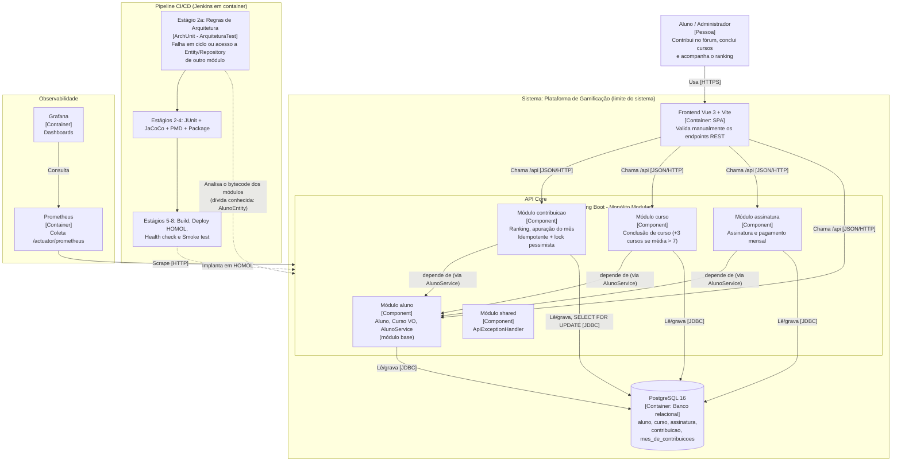

# ADR-001: Monólito Modular com Fronteiras Verificadas no Build e Encerramento de Mês Idempotente

| Campo | Valor |
|---|---|
| **Status** | Aceito |
| **Data** | 2026-11-03 |
| **Decisor** | Tech Lead (equipe: Luan Bruno Domingues de Oliveira, Juan Pedro Jerônimo Guilen) |
| **Desafio** | B1 — Desafio 1: Decidir a arquitetura macro antes de decompor o sistema |
| **Rastreabilidade** | RF → RNF → ASR + RPC → Alternativas → ADR → C4 → Evidência |

## 1. Contexto do Desafio

O MVP de Gamificação para Educação Continuada (AC1) foi concebido para ~1.000 usuários e deve suportar até 100.000. O ranking cresce mais rápido que as demais funcionalidades, enquanto cursos, conquistas e recompensas continuam evoluindo em paralelo. A equipe precisava decidir entre manter o Monólito em Camadas, evoluir para um Monólito Modular ou separar capacidades em serviços.

A análise do código existente (Java 17 / Spring Boot 3.3.3) mostrou que:

- O sistema **já está organizado por módulos de domínio** (`aluno`, `curso`, `assinatura`, `contribuicao`, `shared`), mas esses limites dependiam apenas de disciplina: nada no build impedia ciclos ou o acesso à `Entity`/`Repository` de outro módulo.
- Existia um **defeito de integridade** no módulo `contribuicao`: `encerrarMes` não registrava que o mês já havia sido apurado, então chamá-lo duas vezes concedia o curso duas vezes ao vencedor (e, em caso de empate, sorteava um novo vencedor a cada chamada).
- A apuração do vencedor e a atualização do aluno ocorrem **em uma única transação**; separá-las em serviços exigiria consistência distribuída.

## 2. Requisitos e Restrições

- **RFs (Requisitos Funcionais):**
  - **RF01 — Ranking:** registrar contribuições do mês, consultar o ranking e apurar o vencedor (com sorteio em caso de empate).
  - **RF02 — Conquistas:** conceder cursos/recompensas (curso ao vencedor do mês; +3 cursos ao concluir curso com média > 7).
  - Evolução contínua das funcionalidades existentes.
- **RNFs (Requisitos Não Funcionais — FURPS+):**
  - **Manutenibilidade** (Supportability): evoluir cursos, conquistas e recompensas sem efeito colateral em outros módulos.
  - **Desempenho e escalabilidade** (Performance): ranking com até 100.000 usuários.
  - **Testabilidade:** domínio puro, coberto por testes sem infraestrutura.
  - **Complexidade operacional:** custo de implantar, monitorar e operar.
  - **Confiabilidade/integridade** (Reliability): uma apuração mensal não pode ser executada duas vezes.
- **RPCs (Restrições e Premissas):**
  - Core permanece em **Java 17 / Spring Boot** (premissa do case).
  - **Equipe de 6 desenvolvedores**; capacidade real de execução do laboratório: 2 integrantes.
  - **Banco relacional (PostgreSQL)** e legado da AC1 (modelo de dados e endpoints `/api/...` preservados).
  - Pipeline **Jenkins** já existente (CI/CD com deploy em HOMOL, Actuator/Prometheus/Grafana).
  - **Manter a arquitetura como está** (sem reorganizar pacotes), tratando apenas o defeito identificado.
  - Produção usa `ddl-auto=validate`: alterações de schema precisam ser aplicadas antes do deploy.

## 3. ASRs (Architecturally Significant Requirements)

Foi priorizado **um** ASR para este desafio (o enunciado permite no máximo três):

| ASR | Por que é arquiteturalmente significativo | O que altera | Cenário de qualidade |
|---|---|---|---|
| **ASR-1 — Manutenibilidade** | Cursos, conquistas e recompensas evoluem em paralelo; os limites entre módulos dependiam só de disciplina. | **Estrutura** do Core: dependências sem ciclos e dados privados de cada módulo. | Uma nova regra de ranking ou conquista altera apenas um módulo, e a pipeline falha se houver ciclo ou acesso à Entity/Repository de outro módulo. |

Ficaram fora, por decisão consciente:

- **Escalabilidade do ranking e complexidade operacional:** sem números de carga medidos, a "necessidade comprovada de escala ou deploy independente" não se sustenta. O gargalo conhecido está no acesso a dados (recarga do mês inteiro a cada contribuição e ranking sem agregação), e não na fronteira entre módulos. Registrado como evolução futura.
- **Testabilidade e desempenho:** tratados como qualidades de apoio (meio de verificação do ASR-1), não como direcionadores da estrutura.

## 4. Alternativas e Trade-offs

| Alternativa | Pontos positivos | Pontos negativos | Veredito |
|---|---|---|---|
| **A. Monólito em Camadas** | Simples e conhecido pela equipe; um deploy. | Mudanças espalham arquivos por vários pacotes; sem fronteiras de domínio; contraria o estado atual do código (já modular). | Descartada |
| **B. Monólito Modular** | Mantém um deploy, um banco e uma transação; fronteiras por domínio verificáveis; custo operacional zero; deixa o ranking preparado para extração futura. | Banco compartilhado (acoplamento por tabelas continua possível); exige disciplina e manutenção das regras de arquitetura; não resolve sozinho a escala do ranking. | **Escolhida** |
| **C. Decomposição seletiva em serviço(s)** | Escala e deploy independentes do ranking. | Perde a transação única entre apuração e atualização do aluno (consistência distribuída); quebra a FK `contribuicao → aluno`; adiciona imagem, pipeline, contrato e monitoramento para 2 desenvolvedores efetivos; sem necessidade medida. | Descartada (reavaliar com dados de carga) |

## 5. Decisão do Tech Lead

**Adotamos o Monólito Modular (alternativa B), sem decompor em serviços, e corrigimos o defeito de integridade do encerramento do mês.** O Core segue como um único artefato Spring Boot com um único banco PostgreSQL; a estrutura de pacotes por módulo foi mantida. A modularidade, antes apenas convencionada, passou a ser **verificada pelo build**.

**Como a implementação atende ao ASR-1:**

- **Fronteiras verificadas por código (`ArquiteturaTest`, ArchUnit):** três regras executáveis — (1) módulos sem ciclos de dependência; (2) pacote `domain` sem dependência de Spring/JPA nem de camadas técnicas; (3) `Entity` e `Repository` privados do módulo dono. Qualquer violação reprova o build. Um ciclo "falso" no código-fonte (`Aluno` importando `Assinatura` apenas para Javadoc) foi removido.
- **Dívida técnica explícita e controlada:** `AlunoEntity` ainda é acessada pelos módulos `curso`, `assinatura` e `contribuicao` (via `AlunoService` e associações JPA). Em vez de esconder, a exceção está listada de forma única no teste; **qualquer outra** violação é bloqueada. Quitar a dívida significa fazer o `AlunoService` devolver domínio/ID e esvaziar a lista.
- **Correção do defeito, mantendo a mudança local ao módulo `contribuicao`:** o mês passou a guardar o resultado da apuração (`encerrado` e `vencedor`), e `encerrarCom()` impede, na própria entidade, uma segunda apuração. `encerrarMes` ficou **idempotente** (chamadas seguintes devolvem o mesmo vencedor, sem sorteio nem novo curso) e a busca usa **bloqueio pessimista** (`SELECT ... FOR UPDATE`) para serializar chamadas simultâneas. Um mês encerrado passa a rejeitar novas contribuições (HTTP 409, código já usado para contribuição ignorada), evitando vencedor defasado em relação ao ranking. Nenhuma outra classe de módulo foi alterada, o que demonstra o cenário do ASR-1.
- **Testes:** 43 testes passam (`mvn clean verify`), cobertura total de instruções de 86,1% (79% antes), com as classes de `domain` em 100%. Foram adicionados 5 testes de integração com JPA/H2 reais (idempotência, empate com sorteio único, mês vazio, contribuição em mês encerrado, mês inexistente) e 3 testes de arquitetura. Os testes de arquitetura passaram por **teste de mutação** (ao esvaziar a exceção permitida, a regra falhou apontando `AlunoEntity`), o que revelou e corrigiu uma regra inicialmente vácua.
- **Pipeline CI/CD (Jenkins):** novo estágio **2a — Regras de Arquitetura (ArchUnit)** executa `ArquiteturaTest` antes dos testes completos, isolando no Stage View a falha de arquitetura. Os mesmos testes rodam no `verify` do estágio seguinte, junto com JaCoCo e PMD. A observabilidade existente (Actuator, Prometheus, Grafana) permanece inalterada.

**Consequências e riscos aceitos:**

- **Schema em produção:** com `ddl-auto=validate`, as colunas `encerrado boolean not null default false` e `vencedor_id bigint null references aluno(id)` em `mes_de_contribuicoes` devem ser criadas manualmente antes do deploy (dev/homol usam `update`). O projeto não adota ferramenta de migração (Flyway/Liquibase) neste momento.
- **Concorrência sem teste automatizado:** o bloqueio pessimista é coberto por revisão de código; o teste de concorrência não foi implementado ainda. A garantia verificada automaticamente é a idempotência sequencial.
- **Pipeline não executada no Jenkins nesta etapa:** a validação foi feita localmente com `mvn clean verify`; a execução do estágio 2a no Jenkins fica pendente.
- **Escalabilidade do ranking não resolvida aqui:** permanece como evolução (consulta agregada e paginada, índices em chaves estrangeiras, eventual cache), a decidir com medição de carga.

## 6. Evidência da Resolução (Arquitetura C4 Model)

Diagrama de **Containers (C4 Nível 2)** da plataforma após a decisão: um único container de API (monólito modular) com módulos de dependência acíclica, o gate de arquitetura executado pelo Jenkins e a observabilidade existente.

