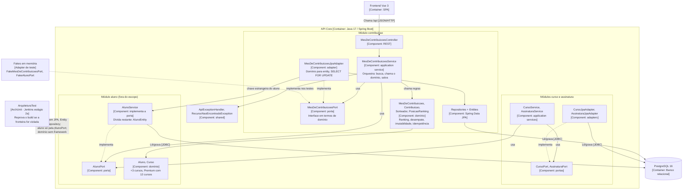

# ADR-002: Ports & Adapters Seletivo no Core, sem Reorganizar Pacotes

| Campo | Valor |
|---|---|
| **Status** | Aceito |
| **Data** | 2026-11-04 |
| **Decisor** | Tech Lead (equipe: Luan Bruno Domingues de Oliveira, Juan Pedro Jerônimo Guilen) |
| **Desafio** | B1 — Desafio 2: Organização interna do Core — proteger o domínio contra dependências técnicas |
| **Relacionado a** | [ADR-001](ADR_desafio1.md) (Monólito Modular; dívida da `AlunoEntity`) |
| **Rastreabilidade** | RF → RNF → ASR + RPC → Alternativas → ADR → C4 → Evidência |

## 1. Contexto do Desafio

As regras de ranking, moedas, badges e recompensas mudam com frequência. O ADR-001 protegeu a fronteira **entre** módulos; este ADR trata da fronteira **dentro** de cada módulo, entre regra de negócio e tecnologia.

A análise do código (commit `429f41c`) mostrou que o pacote `domain` já era puro, mas as regras não estavam todas nele, e os services conheciam a persistência:

- **Regra fora do domínio:** a promoção a Premium com 12 cursos estava no `CursoService`, aplicada sobre a `AlunoEntity`. O próprio comentário do código registrava "não implementada no domínio".
- **Regra duplicada:** a imutabilidade do mês encerrado estava no `MesDeContribuicoesService` e na entidade JPA.
- **Domínio usado só para calcular delta:** o `CursoService` criava um `Aluno` zerado para obter o incremento de cursos e somava o resultado na entidade.
- **Services acoplados ao JPA:** recebiam `Repository` e `Entity` e lançavam `EntityNotFoundException`. Nenhum caso de uso rodava sem banco ou sem mocks de repositório.
- **Escrita implícita:** o curso do vencedor dependia do dirty checking do JPA, sem nenhum `save`.
- **Sorteio não determinístico:** `new Random()` dentro do domínio impedia testar o empate de forma controlada.

## 2. Requisitos e Restrições

- **RFs (Requisitos Funcionais):**
  - **RF01 — Ranking:** registrar contribuições, consultar o ranking e apurar o vencedor do mês.
  - **RF02 — Conquistas e regras de gamificação:** curso ao vencedor, bônus de +3 cursos com média > 7, Premium com 12 cursos.
- **RNFs (Requisitos Não Funcionais — FURPS+):**
  - **Manutenibilidade** (Supportability): entender onde cada regra mora.
  - **Testabilidade** (Supportability): verificar regras e casos de uso sem infraestrutura.
  - **Modificabilidade** (Supportability): alterar uma regra sem tocar em banco, framework ou API.
  - **Facilidade de evolução** (Supportability): acrescentar regras sem reescrever camadas.
- **RPCs (Restrições e Premissas):**
  - Core continua em **Spring Boot** (Java 17).
  - **Regras existentes devem ser reaproveitadas.**
  - **Não é permitido reescrever o produto** apenas para aplicar um padrão.
  - **Manter a organização de pacotes** atual (decisão da equipe, herdada do ADR-001).
  - Schema e endpoints da AC1 preservados; produção usa `ddl-auto=validate`.
  - Sem teste de concorrência nesta etapa (risco já aceito no ADR-001).

## 3. ASRs (Architecturally Significant Requirements)

Foram priorizados **dois** ASRs (o enunciado permite no máximo três):

| ASR | Por que é arquiteturalmente significativo | O que altera | Cenário de qualidade |
|---|---|---|---|
| **ASR-2 — Modificabilidade** | As regras de gamificação são o que mais muda no produto, e uma regra podia estar em três lugares. | **Estrutura:** cada regra passa a ter um único lugar, o domínio. | Trocar o critério de apuração altera uma única classe de produção, sem mudar entity, repository, controller ou schema. |
| **ASR-3 — Testabilidade** | Sem separar a persistência, nenhum caso de uso roda sem banco ou mocks de repositório. | **Estrutura e dependências:** os services dependem de portas, e não do JPA. | O mesmo caso de uso roda com um fake em memória e com o adapter JPA, e a mesma suíte de contrato valida os dois. |

Ficaram fora, por decisão consciente:

- **Manutenibilidade:** já é o ASR-1 do ADR-001. Aqui é reforçada como consequência, e as regras do ArchUnit continuam sendo o mecanismo.
- **Facilidade de evolução:** é efeito dos dois ASRs acima; sozinha não muda nenhuma decisão de estrutura.

## 4. Alternativas e Trade-offs

| Alternativa | Pontos positivos | Pontos negativos | Veredito |
|---|---|---|---|
| **A. Manter a estrutura atual** | Custo zero; sem mapeamento domínio ↔ entity. | Regras espalhadas; casos de uso não testáveis sem banco ou mocks; a frequência de mudança das regras mantém o custo sempre presente. | Descartada |
| **B. Hexagonal completa** (pacotes `domain/application/adapter`) | Fronteiras explícitas na própria árvore de pacotes. | Move todos os módulos; contraria a RPC de manter os pacotes e a de não reescrever só para aplicar um padrão; custo desproporcional ao problema. | Descartada |
| **C. Ports & Adapters seletivo nos pacotes existentes** | Inverte só a dependência que dói; sem pacotes novos, sem mudança de schema nem de Jenkinsfile; fronteira verificada no build. | Mais classes (porta e adapter) e mais mapeamento; módulos com estilos diferentes; a estrutura de pacotes não mostra a fronteira, quem mostra é o ArchUnit. | **Escolhida** |

**DDD, Hexagonal, Clean e Onion são concorrentes?** Não, respondem a perguntas diferentes e podem ser combinados. Usamos o **modelo tático do DDD** (agregado `MesDeContribuicoes`, regras no domínio) e a **inversão de dependência da Hexagonal** (portas e adapters). Clean e Onion chegam à mesma regra de dependência com mais camadas nomeadas; aqui só somariam classes, sem ganho no problema atual.

## 5. Decisão do Tech Lead

**Adotamos Ports & Adapters seletivo (alternativa C) nos módulos `contribuicao`, `curso` e `assinatura`, mantendo a organização de pacotes.**

**Qual dependência realmente precisa ser invertida?** Só uma: **application service → persistência**. O domínio já era puro (regra do ADR-001), e os controllers já dependiam apenas dos services. Além dela, o sorteio virou a interface `Sorteador`, para que o empate seja testável.

**O custo estrutural é proporcional ao problema?** Sim. A mudança acrescentou 4 portas, 3 adapters e 3 tipos de apoio (`Sorteador`, `PosicaoRanking`, `RecursoNaoEncontradoException`). Não criou pacote novo, não mudou o schema e não alterou o Jenkinsfile. O módulo `aluno` ficou fora do escopo: o `AlunoService` apenas implementa a `AlunoPort`.

**Como a implementação atende aos ASRs:**

- **Regras no domínio (ASR-2):** `MesDeContribuicoes` concentra ranking por soma de pesos, desempate, imutabilidade do mês encerrado e idempotência. `Aluno` passou a ter a regra de Premium. `restaurar()` reidrata o mês sem reaplicar `registrar()`, para que uma mudança futura na regra de duplicidade não descarte contribuições já gravadas. A soma usa `BigDecimal`, então 0,1 + 0,2 empata com 0,3.
- **Services como orquestradores (ASR-2 e ASR-3):** os três seguem o mesmo fluxo: buscar pela porta, chamar o domínio e salvar.
- **Portas no pacote `service`, em termos de domínio:** `MesDeContribuicoesPort`, `CursoPort`, `AssinaturaPort` e `AlunoPort`. O lock `SELECT ... FOR UPDATE` virou detalhe do adapter, atrás de `buscarParaEncerramento`.
- **Adapters JPA no pacote `repository`:** `MesDeContribuicoesJpaAdapter`, `CursoJpaAdapter` e `AssinaturaJpaAdapter` fazem a tradução domínio ↔ entity. A escrita do curso do vencedor agora é explícita.
- **Exceção neutra:** `RecursoNaoEncontradoException` substitui a exceção do JPA nos services e na `AlunoPort`. O `ApiExceptionHandler` trata as duas com HTTP 404.
- **Fronteira verificada no build (`ArquiteturaTest`):** três regras novas somam-se às três do ADR-001: (4) services dos três módulos sem `jakarta.persistence`, Spring Data, `entity` ou `repository`; (5) acesso ao aluno só pela `AlunoPort`, nunca pelo `AlunoService`; (6) portas sempre no pacote `service`.
- **Pipeline CI/CD (Jenkins):** as novas regras entram no estágio **2a** sem alterar o Jenkinsfile, porque ele já executa `ArquiteturaTest`.
- **Dívida da `AlunoEntity`, quitada em parte:** saiu dos services e ficou confinada aos adapters e às associações JPA.

**Consequências e riscos aceitos:**

- **Mais classes e mais mapeamento:** cada campo novo do agregado exige ajuste no adapter.
- **Estilos diferentes:** o módulo `aluno` não tem adapter separado e convive com os três módulos refatorados.
- **Vazamento pequeno na `AlunoPort`:** `salvar` devolve `AlunoResponse`, um DTO, em vez de um tipo de domínio. Foi mantido para reaproveitar o mapeamento existente.
- **Dívida restante:** adapters e associações JPA ainda dependem de `AlunoEntity`. Quitar exige trocar as associações por ID do aluno.
- **Fake não simula lock:** o `SELECT ... FOR UPDATE` não é exercitado pelo fake, e continua sem teste de concorrência.
- **Sem teste automatizado de HTTP:** controllers e `ApiExceptionHandler` seguem com 0% de cobertura. A resposta da API foi conferida manualmente em H2, não no PostgreSQL.
- **Pipeline não executada no Jenkins nesta etapa:** a validação foi local, com `mvn clean verify`.

**Mudanças de comportamento da API:**

- `GET /api/meses/{descricao}/ranking` agora devolve **uma linha por aluno**, em ordem decrescente, em vez de uma linha por contribuição.
- O campo da resposta mudou de `peso` para **`pontos`**, porque passou a carregar o total do aluno. É uma quebra de contrato, e o frontend foi ajustado junto. O `peso` da requisição de contribuição não mudou.
- O critério de apuração passou de **número de contribuições** para **soma dos pesos**. Um aluno com menos contribuições pode vencer.
- A mensagem de erro de assinatura para aluno inexistente mudou. O status continua 404.

## 6. Evidência da Resolução

### Mini-lab: isolar uma regra e trocar o adapter

A regra isolada é a apuração do mês (`MesDeContribuicoes`). O adapter trocado é a persistência:

| Peça | Papel |
|---|---|
| `ContribuicaoTest`, `AlunoTest` | Domínio puro, sem Spring e sem banco. Sorteio controlado pelo `Sorteador`. |
| `FakeMesDeContribuicoesPort`, `FakeAlunoPort` (`src/test/.../fake/`) | Adapters em memória. Devolvem cópias, como um banco, para não esconder escrita implícita. |
| `MesDeContribuicoesServiceTest` | Casos de uso sem Spring e sem banco, com os fakes. |
| `MesDeContribuicoesPortContract` | **Mesma suíte** de contrato, executada por `MesDeContribuicoesFakePortTest` (fake) e `MesDeContribuicoesJpaPortTest` (JPA real em H2, com flush e clear). Se o fake divergir do banco, um dos dois reprova. |
| `AdaptersJpaIntegrationTest`, `EncerramentoDoMesIntegrationTest` | Ciclo gravar/ler com JPA real. |

### Resultados medidos

| Verificação | Resultado |
|---|---|
| `mvn clean verify` | **86 testes, 0 falhas**, cobertura total de instruções de **89,3%** (86,1% no ADR-001). Classes de `domain`, o VO `Curso` e os três adapters em 100%. |
| **Experimento do ASR-2:** trocar temporariamente a soma de pesos por contagem | **1 linha em 1 classe de produção.** Reprovaram 5 testes: 3 no `ContribuicaoTest` e 2 no `MesDeContribuicoesServiceTest`. Nenhum teste de JPA, de contrato ou de integração foi afetado. |
| **Mutação das regras novas do ArchUnit:** classes temporárias violando cada regra | As regras 4, 5 e 6 reprovaram, cada uma apontando a classe injetada. As classes foram removidas e o `verify` voltou a passar. |
| **Divergência pega na revisão:** `AlunoService.obter` lançava a exceção do JPA, e a porta e o fake prometiam `RecursoNaoEncontradoException` | Corrigida. A suíte de contrato cobre `MesDeContribuicoesPort`, não a `AlunoPort`; esta foi achada por leitura de código. |
| **Conferência manual da API** (aplicação em H2 + `curl`) | Ranking com `pontos` e ordem decrescente; contribuição consecutiva e mês encerrado com 409; segundo encerramento devolve o mesmo vencedor; recurso inexistente com 404. |

### C4 Component do Core

Diagrama de **Componentes (C4 Nível 3)** da API Core. O módulo `contribuicao` aparece detalhado; `curso` e `assinatura` seguem o mesmo desenho. As setas apontam no sentido da dependência: o adapter depende da porta, e não o contrário.

