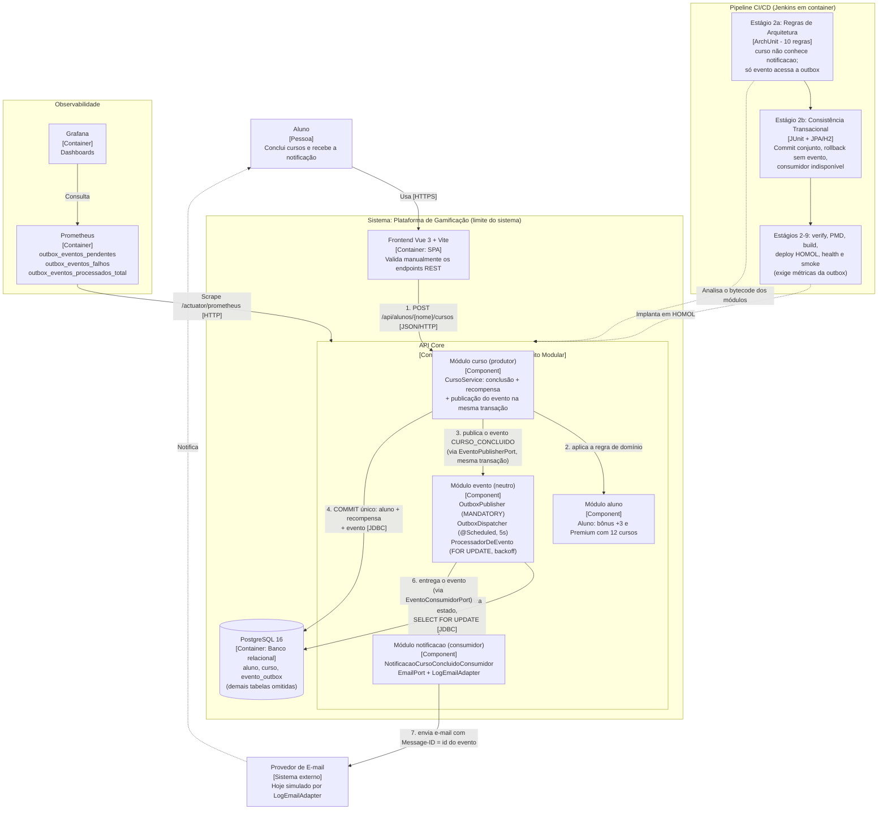

# ADR-004: Transactional Outbox no PostgreSQL para Comunicação por Eventos, Garantindo Consistência entre Conclusão de Curso, Recompensa e Notificação

| Campo | Valor |
|---|---|
| **Status** | Aceito |
| **Data** | 2026-11-04 |
| **Decisor** | Tech Lead (equipe: Luan Bruno Domingues de Oliveira, Juan Pedro Jerônimo Guilen) |
| **Desafio** | B1 — Desafio 4: Comunicação e eventos |
| **Relacionado a** | [ADR-001](ADR_desafio1.md) (Monólito Modular, transação única), [ADR-002](ADR_desafio2.md) (Ports & Adapters) |
| **Rastreabilidade** | RF → RNF → ASR + RPC → Alternativas → ADR → C4 → Evidência |

## 1. Contexto do Desafio

Ao concluir um curso, o sistema registra a conclusão, calcula a recompensa (+3 cursos com média acima de 7 e promoção a Premium com 12 cursos) e passa a precisar notificar o aluno por e-mail. Uma falha na notificação não pode impedir a conclusão do curso.

A análise do código (Java 17 / Spring Boot 3.3.3) mostrou que:

- A conclusão é um fluxo síncrono em **uma única transação** (`CursoService`): carrega o aluno, aplica a regra de domínio e salva.
- **Não existia nenhum mecanismo de eventos, consumidor, cliente HTTP ou broker.** A RPC do "consumidor indisponível" era hipotética e precisou ser criada e simulada.
- Chamar o notificador de dentro dessa transação traria dois riscos: segurar uma conexão do banco durante uma chamada de rede e, em caso de erro, desfazer a conclusão.
- O problema difícil não é "tornar assíncrono", e sim a **escrita dupla**: gravar no banco e comunicar um sistema externo não são atômicos. Publicar depois do commit pode perder o evento; publicar antes pode gerar um evento de algo que sofreu rollback.

## 2. Requisitos e Restrições

- **RFs (Requisitos Funcionais):**
  - **RF02 — Conquistas:** conceder +3 cursos (média > 7) e promover a Premium com 12 cursos, de forma imediata.
  - **RF05 — Notificações:** avisar o aluno por e-mail que concluiu o curso.
  - Eventos associados à conclusão de atividades (base para analytics futuro).
- **RNFs (Requisitos Não Funcionais — FURPS+):**
  - **Consistência** (Reliability): conclusão, recompensa e intenção de notificar confirmadas ou desfeitas juntas.
  - **Tolerância a falhas e recuperabilidade** (Reliability): consumidor indisponível não afeta a conclusão, e os eventos pendentes são entregues quando ele volta.
  - **Disponibilidade e latência:** a resposta da conclusão não depende de rede externa.
  - **Desacoplamento e testabilidade** (Supportability): produtor e consumidor só se conhecem pelo contrato do evento.
  - **Observabilidade:** o backlog e as falhas de entrega precisam estar visíveis.
- **RPCs (Restrições e Premissas):**
  - Operações essenciais do Core devem concluir mesmo com consumidor externo indisponível.
  - Adoção de broker exige custo operacional (mais um serviço nos 3 arquivos Compose e no deploy de HOMOL).
  - Core permanece em **Java 17 / Spring Boot**, **monólito modular** com um único PostgreSQL (ADR-001).
  - Services dependem de portas, e o domínio não conhece framework (ADR-002).
  - Equipe de 6 desenvolvedores, com capacidade efetiva de 2 neste laboratório.
  - Produção usa `ddl-auto=validate` e o projeto não adota Flyway/Liquibase: a nova tabela exige DDL manual.
  - Decisão do Tech Lead: **a recompensa fica imediata, na mesma transação da conclusão, e não se adota broker**.

## 3. ASRs (Architecturally Significant Requirements)

Foi priorizado **um** ASR (o enunciado permite no máximo três):

| ASR | Por que é arquiteturalmente significativo | O que altera | Cenário de qualidade |
|---|---|---|---|
| **ASR-6 — Consistência** | Define a fronteira da transação e impede eventos fantasmas ou perdidos. Mantém a posição do ADR-001 de evitar consistência distribuída na recompensa. | **Dados e limite transacional:** conclusão, recompensa e intenção de notificar são gravadas juntas. | Um rollback não gera evento, todo commit gera exatamente um evento lógico, e reentregas não duplicam notificação nem recompensa. |

Ficaram fora, por decisão consciente:

- **Tolerância a falhas e recuperabilidade:** tratadas como consequência do ASR-6. A durabilidade do evento no banco é o que permite retentar após uma indisponibilidade.
- **Disponibilidade:** continua limitada pelo PostgreSQL, e isso não muda aqui.
- **Latência:** sem meta nem medição. Tirar a rede do caminho crítico já a resolve como efeito colateral.
- **Desacoplamento:** é meio, não fim. É verificado por regras de arquitetura no build.

## 4. Alternativas e Trade-offs

| Alternativa | Pontos positivos | Pontos negativos | Veredito |
|---|---|---|---|
| **A. REST síncrono para o notificador** | Simples; resposta imediata. | A chamada de rede fica dentro da transação (conexão presa); a falha do e-mail desfaz a conclusão ou, se engolida, perde a notificação. Viola a RPC. | Descartada |
| **B. Evento em memória após o commit** (`@TransactionalEventListener`) | Sem infraestrutura nova; desacopla a chamada. | O evento não é durável: se o Core cair entre o commit e o envio, a notificação se perde, e não há retentativa. Falha o ASR-6. | Descartada |
| **C. Broker sem outbox** (RabbitMQ ou Kafka) | Desacoplamento e entrega assíncrona. | Escrita dupla: ou existe evento sem fato, ou fato sem evento. O broker não resolve a atomicidade com o banco. | Descartada |
| **D. Outbox + RabbitMQ** | Fila, reentrega e roteamento prontos; adequado a vários consumidores fora do processo. | A outbox continua necessária; acrescenta um serviço a operar, monitorar e implantar nos 3 ambientes, sem consumidor externo que o justifique. | Descartada (reavaliar com consumidores externos) |
| **E. Outbox + Kafka** | Replay e alta vazão. | Maior custo operacional; o volume do case (poucos eventos por minuto) não exige vazão nem replay. | Descartada |
| **F. Outbox no PostgreSQL com dispatcher interno** | Atomicidade com o fato pela mesma transação; durável; reaproveita banco, Actuator e Prometheus; custo operacional baixo; o dispatcher pode virar relay para um broker sem alterar produtores. | Entrega pelo menos uma vez (possível duplicata); polling no banco não escala como broker; tabela nova com DDL manual em produção; atraso de até 5 s. | **Escolhida** |

## 5. Decisão do Tech Lead

**Adotamos o padrão Transactional Outbox no PostgreSQL, com um dispatcher interno e sem broker (alternativa F).** A recompensa permanece imediata e na mesma transação da conclusão. O e-mail é entregue depois do commit, por um módulo consumidor desacoplado, com retentativa automática.

**Resposta às perguntas do desafio:**

- **O que é imediato:** registrar a conclusão e calcular a recompensa, porque estão no mesmo agregado `Aluno` e a resposta da API já os devolve.
- **O que é eventual:** a notificação e, no futuro, o analytics.
- **Que ASR justifica mensageria:** a recuperabilidade. Ela exige durabilidade do evento, que a tabela outbox entrega sem broker.
- **RabbitMQ ou Kafka resolvem um problema real do fluxo?** Hoje não. O problema real é a atomicidade com o banco, que exige a outbox de qualquer forma. RabbitMQ seria o próximo passo com consumidores fora do processo, por ser mais adequado a entrega de tarefas que Kafka.

**Como a implementação atende ao ASR-6:**

- **Fronteira transacional:** o `CursoService` carrega o aluno, aplica a regra, salva e publica o evento, tudo no mesmo `@Transactional`. O domínio devolve o fato (`ConclusaoDeCurso`), e o evento `CursoConcluido` é montado a partir dele, sem recalcular regra.
- **Publicação só dentro da transação:** o `OutboxPublisher` usa `Propagation.MANDATORY`. Publicar sem transação falha de forma explícita, em vez de gravar o evento "por fora".
- **Entrega fora da transação do fato:** o `OutboxDispatcher` (`@Scheduled`, `fixedDelay` de 5 s) varre os eventos pendentes. O `ProcessadorDeEvento` entrega um evento por transação, relendo-o com `SELECT ... FOR UPDATE` para que duas instâncias não enviem o mesmo evento. A falha do consumidor é registrada no próprio evento e nunca propagada à conclusão.
- **Retentativa e recuperabilidade:** backoff exponencial de 30 s a 240 s e, na 5ª falha, o evento vira `FALHOU` (dead letter). Os eventos acumulados durante uma indisponibilidade são entregues quando o consumidor volta.
- **Reentrega sem duplicar:** o evento `ENVIADO` não é reprocessado, e o id do evento é a chave de idempotência enviada como `Message-ID`. A recompensa não é afetada porque a entrega nunca a toca.
- **Desacoplamento:** o módulo `curso` publica pela `EventoPublisherPort` e não conhece `notificacao`. O módulo `notificacao` implementa a `EventoConsumidorPort` e envia o e-mail pela `EmailPort`, cujo adapter atual (`LogEmailAdapter`) escreve no log.
- **Testes:** 124 testes passam (`mvn clean verify`), com cobertura total de instruções de 91,4% (89,3% no ADR-002). O teste de integração com JPA e H2 reais cobre o commit conjunto, o rollback sem evento fantasma, a falha ao gravar o evento, a publicação fora de transação e o ciclo "consumidor fora do ar → evento pendente → consumidor volta → um único e-mail". Testes sem Spring, com relógio controlável, cobrem backoff, backlog, esgotamento de tentativas e reentrega. Quatro novas regras no `ArquiteturaTest`, que somam 10 regras no total, impedem que `curso` conheça `notificacao`, que `evento` conheça produtores e consumidores, que services de `evento` e `notificacao` usem JPA e que alguém fora de `evento` acesse a outbox.
- **Teste de mutação:** trocar `MANDATORY` por `REQUIRES_NEW` reprovou 2 testes (o evento fantasma sobrevive ao rollback: esperado 0, obtido 1); fazer `curso` importar `notificacao` reprovou o ArchUnit; remover a checagem de estado na reentrega reprovou o teste de reentrega.
- **Pipeline CI/CD (Jenkins):** novo estágio **2b — Consistência Transacional (Outbox, ASR-6)**, executado antes do `verify`, isola no Stage View a falha de atomicidade. As regras novas do ArchUnit já entram no estágio 2a sem alterar o Jenkinsfile. O smoke test passou a exigir as métricas da outbox em `/actuator/prometheus`.
- **Observabilidade:** o gauge `outbox_eventos_pendentes` indica o backlog (cresce quando o consumidor cai), o gauge `outbox_eventos_falhos` indica os eventos que exigem intervenção, e o contador `outbox_eventos_processados_total{resultado}` separa enviado, reagendado, falhou e ignorado. Usam o Actuator, o Prometheus e o Grafana já existentes.

**Consequências e riscos aceitos:**

- **Entrega pelo menos uma vez:** se o Core cair depois do envio do e-mail e antes do commit, o e-mail é reenviado. O `Message-ID` só evita a duplicata se o provedor deduplicar, o que o adapter de log não faz.
- **Janela de recuperação limitada:** com 5 tentativas, uma indisponibilidade maior que cerca de 7,5 minutos leva o evento a `FALHOU`. Não há endpoint de reprocessamento manual.
- **Schema em produção:** com `ddl-auto=validate`, a tabela deve ser criada antes do deploy com `scripts/sql/evento_outbox.sql`. O DDL foi escrito para o Hibernate 6, mas não foi validado em PostgreSQL real.
- **Defeito da conclusão repetida não corrigido:** o `Aluno` não registra que o curso foi concluído, então um POST repetido gera outra conclusão legítima, com bônus e evento novos, como na AC1. A chave de idempotência do evento identifica o evento, não a conclusão. É a mesma classe de defeito do `encerrarMes` corrigido no ADR-001, e fica como evolução.
- **E-mail do aluno derivado do nome:** o modelo não tem o campo; o endereço é montado por convenção até existir um campo próprio.
- **Sem teste de concorrência real:** o lock `FOR UPDATE` com duas instâncias não foi exercitado, e a regra continua a ser coberta por revisão de código.
- **Lacunas de verificação:** a aplicação não foi executada contra PostgreSQL real, o estágio 2b não foi executado no Jenkins e o `@Scheduled` não foi exercitado em contexto Spring completo. A validação foi local, com `mvn clean verify`. O `LogEmailAdapter` tem 0% de cobertura.
- **Escala do polling:** adequado ao volume atual. Com consumidores externos ou volume maior, o dispatcher passa a ser um relay para RabbitMQ, e produtores e outbox permanecem iguais.

## 6. Evidência da Resolução (Arquitetura C4 Model)

Diagrama de **Containers (C4 Nível 2)** após a decisão: o fato e a intenção de notificar são gravados na mesma transação no PostgreSQL, e o dispatcher entrega o e-mail depois do commit, de forma desacoplada. O fluxo crítico está numerado.

